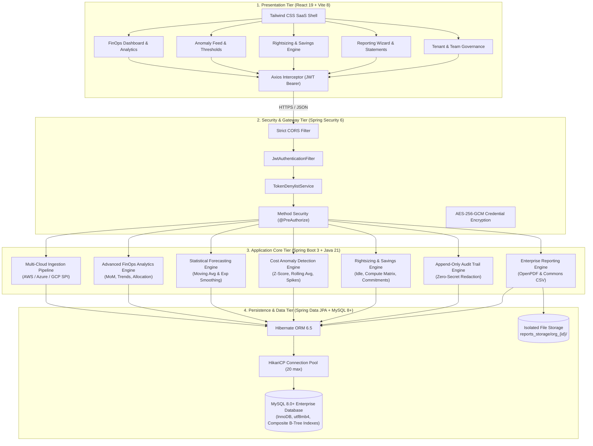

# CloudCost AI
### Intelligent Cloud Cost Monitoring & FinOps Analytics Platform

[](https://openjdk.org/projects/jdk/21/)
[](https://spring.io/projects/spring-boot)
[](https://react.dev/)
[](https://vitejs.dev/)
[](https://tailwindcss.com/)
[](https://www.mysql.com/)
[](LICENSE)

---

## 1. Project Overview & Objectives
**CloudCost AI** is a professional full-stack FinOps SaaS platform engineered to help enterprises monitor multi-cloud expenditures across **Amazon Web Services (AWS)**, **Google Cloud Platform (GCP)**, and **Microsoft Azure**. The platform tracks granular cloud billing records, enforces budget limits, detects unusual spending anomalies, and provides automated cost-optimization insights.

The platform is designed following industry-standard software engineering best practices, SOLID design principles, clean architecture, and decoupled client-server paradigms suitable for enterprise deployment and technical demonstrations in Full Stack Developer interviews.

---

## 2. Mandatory Technology Stack

- **Backend**:
  - **Language**: Java 21 (LTS)
  - **Framework**: Spring Boot 3.3.5
  - **Modules**: Spring Web, Spring Data JPA, Hibernate ORM, Spring Boot Validation, Spring Security 6, Spring Boot Actuator
  - **Database Driver**: MySQL Connector/J 8.x
  - **Connection Pool**: HikariCP
  - **API Documentation**: Springdoc OpenAPI v2.6.0 (Swagger UI v3)
  - **Testing**: JUnit 5, Mockito, AssertJ, Spring MockMvc
  - **Build Tool**: Apache Maven 3.9+ / Maven Wrapper (`mvnw`)
- **Frontend**:
  - **Language**: JavaScript (ES6+ / JSX)
  - **Library**: React.js 19
  - **Tooling**: Vite 8.x
  - **Styling**: Tailwind CSS 3.4 (with dark mode tokens & glassmorphism)
  - **Routing**: React Router DOM v7
  - **HTTP Client**: Axios (centralized interceptors)
  - **Visualization**: Chart.js & React-Chartjs-2
  - **Icons**: Lucide React
- **Database**:
  - **Engine**: MySQL 8.0+
  - **Schema**: `cloudcost_ai` (InnoDB, UTF-8 MB4)
- **Deployment & DevOps**:
  - **Containers**: Docker & Docker Compose
  - **Frontend Target**: Vercel
  - **Backend Target**: Render (Web Service + Managed MySQL)
  - **Testing**: Postman Collection & Environment

---

## 3. System Architecture

CloudCost AI is organized into a clean 4-tier decoupled enterprise architecture:



---

## 4. Folder Structure

```
CloudCost-AI/
├── .gitignore                                # Comprehensive Git ignore rules
├── .env.example                              # Documented environment variables template
├── docker-compose.yml                        # Multi-container orchestration (MySQL, Backend, Frontend)
├── README.md                                 # Complete project documentation
│
├── backend/                                  # Spring Boot 3 Application (Java 21)
│   ├── Dockerfile                            # Multi-stage Dockerfile (Eclipse Temurin 21)
│   ├── mvnw / mvnw.cmd                       # Maven Wrapper executables
│   ├── pom.xml                               # Maven project definition and dependencies
│   └── src/
│       ├── main/
│       │   ├── java/com/cloudcostai/
│       │   │   ├── CloudCostAiApplication.java # Spring Boot entry point
│       │   │   ├── config/                   # WebMvc, CORS, and OpenAPI configurations
│       │   │   ├── controller/               # REST API Controllers (Root, Health, Status)
│       │   │   ├── dto/                      # Data Transfer Objects & ApiResponse envelope
│       │   │   ├── entity/                   # BaseEntity and domain entities
│       │   │   ├── exception/                # GlobalExceptionHandler & custom exceptions
│       │   │   ├── repository/               # BaseRepository and persistence interfaces
│       │   │   ├── security/                 # SecurityConfig & JwtProperties
│       │   │   ├── service/                  # Business logic & health indicators
│       │   │   └── validation/               # Validation annotations & helpers
│       │   └── resources/
│       │       ├── application.properties    # Base environment configuration
│       │       ├── application-dev.properties # Development profile
│       │       └── application-prod.properties# Production profile
│       └── test/java/com/cloudcostai/
│           ├── CloudCostAiApplicationTests.java
│           ├── controller/                   # MockMvc Controller Integration Tests
│           └── service/                      # Mockito Service Unit Tests
│
├── frontend/                                 # React.js Application (Vite)
│   ├── Dockerfile                            # Multi-stage Dockerfile (Node.js + Nginx)
│   ├── nginx.conf                            # Nginx production reverse proxy & SPA fallback
│   ├── package.json                          # Dependencies & build scripts
│   ├── tailwind.config.js                    # Tailwind theme configuration
│   ├── postcss.config.js                     # PostCSS plugins
│   ├── vite.config.js                        # Vite bundler configuration
│   ├── .env / .env.example                   # Frontend environment variables
│   └── src/
│       ├── assets/                           # Static graphics and icons
│       ├── components/                       # Reusable UI components
│       ├── context/                          # SystemContext for reactive health state
│       ├── hooks/                            # Custom hooks (useHealth, useSystemStatus)
│       ├── layouts/                          # Application shell layouts
│       ├── pages/                            # Routed pages (HomePage, HealthPage, StatusPage, DocsPage)
│       ├── services/                         # Centralized Axios client (api.js, systemService.js)
│       ├── utils/                            # Formatting utilities
│       ├── App.jsx                           # Route configuration
│       ├── index.css                         # Tailwind directives & design tokens
│       └── main.jsx                          # React application entry point
│
├── database/                                 # Database scripts & schema documentation
│   ├── schema.sql                            # Complete DDL script for MySQL 8+
│   ├── milestone6_migration.sql              # B-Tree optimization indexes for FinOps analytics
│   ├── milestone7_migration.sql              # Anomaly engine schema, history, configs & notifications
│   └── README.md                             # Database design and migration guide
│
├── sample_data/                              # Mock and seed test datasets
│   ├── seed_data.sql                         # Initial organization and user seed records
│   └── sample_billing_records.json           # Sample cloud spend records (AWS, GCP)
│
├── postman/                                  # API Testing Suite
│   ├── CloudCost AI – API Testing.postman_collection.json # 11 folders, 110+ requests
│   └── CloudCost AI – Local Development.postman_environment.json
│
└── docs/                                     # In-depth architectural & API documents
    ├── architecture.md                       # Comprehensive design specifications
    ├── backend-api.md                        # Complete REST endpoint specifications & contracts
    ├── advanced-analytics.md                 # Milestone 6 FinOps analytics formulas & architecture
    ├── cost-forecasting.md                   # Statistical forecasting models (MA & SES) + 95% CI
    ├── finops-insights.md                    # Rule-based FinOps intelligence engine & severity tiers
    ├── anomaly-detection.md                  # Milestone 7 Real-time statistical anomaly engine & rules
    ├── billing-ingestion.md                  # Multi-cloud ingestion, idempotency & deduplication
    ├── cloud-integrations.md                 # AWS, Azure & GCP credentials and SPI integrations
    ├── security.md                           # AES-256-GCM encryption & JWT RBAC tenant isolation
    └── deployment.md                         # Vercel & Render deployment guide
```

---

## 5. Prerequisites

Before running the application locally, ensure you have:
- **Java JDK 21+** (`java -version`)
- **Apache Maven 3.9+** (`mvn -version`) or use the included `./mvnw`
- **Node.js v18+ & npm v9+** (`node -v && npm -v`)
- **MySQL Server 8.0+** (`mysql -V`) running on port `3306`
- **Docker Desktop** (optional, for containerized execution)

---

## 6. Installation & Quick Start

### 6.1 Database Initialization (MySQL)
Ensure your MySQL server is running, then execute the schema script:

```bash
# Connect to MySQL CLI
mysql -u root -p

# Create database and apply schema
CREATE DATABASE IF NOT EXISTS cloudcost_ai CHARACTER SET utf8mb4 COLLATE utf8mb4_unicode_ci;
exit;

# Import schema and seed data
mysql -u root -p cloudcost_ai < database/schema.sql
mysql -u root -p cloudcost_ai < sample_data/seed_data.sql
```

### 6.2 Backend Startup (Spring Boot)
1. Navigate to the backend directory:
   ```bash
   cd backend
   ```
2. Configure database credentials if different from defaults (`root` / `root`):
   ```bash
   # Set environment variables (or rely on application.properties defaults)
   export DB_URL="jdbc:mysql://localhost:3306/cloudcost_ai?useSSL=false&serverTimezone=UTC&allowPublicKeyRetrieval=true"
   export DB_USERNAME="root"
   export DB_PASSWORD="your_password"
   ```
3. Run tests and start the server:
   ```bash
   # Execute unit & integration tests
   ./mvnw test

   # Launch Spring Boot
   ./mvnw spring-boot:run
   ```
4. Verify backend status:
   - Root Discovery: `http://localhost:8080/`
   - Health Probe: `http://localhost:8080/api/health`
   - System Status: `http://localhost:8080/api/status`
   - Interactive Swagger UI: `http://localhost:8080/swagger-ui.html`

### 6.3 Frontend Startup (React + Vite)
1. In a separate terminal, navigate to the frontend directory:
   ```bash
   cd frontend
   ```
2. Install dependencies:
   ```bash
   npm install
   ```
3. Verify or adjust `.env`:
   ```bash
   VITE_API_BASE_URL=http://localhost:8080
   ```
4. Launch development server:
   ```bash
   npm run dev
   ```
5. Open your browser at `http://localhost:5173`.

---

## 7. Automated Verification & Testing

### 7.1 Backend Unit & Integration Tests (JUnit 5 + Mockito)
Execute all backend tests:
```bash
cd backend
./mvnw clean test
```
**Test Results:**
- `CloudCostAiApplicationTests`: Context load verification.
- `RootControllerTest`: MockMvc assertion on `GET /` returning 200 OK, JSON structure, and endpoint links.
- `HealthControllerTest`: MockMvc assertion on `GET /api/health` returning 200 OK and database health status.
- `StatusControllerTest`: MockMvc assertion on `GET /api/status` returning 200 OK, Java version, and active modules.
- `HealthServiceTest`: Mockito unit test validating health calculation under UP and DEGRADED database states.

### 7.2 Frontend Production Build Verification
Verify that the React production bundle compiles without warnings or errors:
```bash
cd frontend
npm run build
```

### 7.3 Postman API Testing
1. Launch **Postman**.
2. Click **Import** and select:
   - `postman/CloudCost AI – API Testing.postman_collection.json`
   - `postman/CloudCost AI – Local Development.postman_environment.json`
3. Select the active environment: **CloudCost AI – Local Development**.
4. Run the collection using the **Postman Collection Runner**.
5. All test scripts will assert:
   - HTTP 200 OK status codes
   - `Content-Type: application/json` headers
   - Standardized `ApiResponse` envelope (`success: true`)
   - Accuracy of health and runtime diagnostics data

---

## 8. REST API Endpoints Specification

| Method | Endpoint | Description | Auth Level |
|---|---|---|---|
| `POST` | `/api/auth/register` | Register new user account and organization tenant | Public |
| `POST` | `/api/auth/login` | Authenticate credentials and receive signed JWT | Public |
| `GET` | `/api/auth/me` | Retrieve authenticated user profile and tenant context | `AUTHENTICATED` |
| `POST` | `/api/auth/logout` | Revoke active JWT token via server-side denylist | `AUTHENTICATED` |
| `GET` | `/api/admin/users` | Retrieve organization user roster | `ROLE_ADMIN` |
| `GET` | `/` | Root API platform metadata and endpoint discovery | Public |
| `GET` | `/api/health` | Application health and live MySQL `SELECT 1` ping | Public |
| `GET` | `/api/status` | Runtime diagnostics, JVM memory meters, and modules | Public |
| `GET` | `/api/cloud-accounts` | List all registered cloud provider accounts (Tenant Isolated) | `AUTHENTICATED` |
| `POST` | `/api/cloud-accounts` | Register new cloud account connection | `AUTHENTICATED` |
| `POST` | `/api/cloud-accounts/{id}/connect` | Securely encrypt (AES-256-GCM) and connect credentials | `AUTHENTICATED` |
| `POST` | `/api/cloud-accounts/{id}/validate`| Validate live IAM/RBAC permissions for connected account | `AUTHENTICATED` |
| `POST` | `/api/cloud-accounts/{id}/disconnect`| Disconnect and wipe stored encrypted credentials | `AUTHENTICATED` |
| `GET` | `/api/cloud-accounts/{id}/connection-status`| Get live connection, credential, and sync status | `AUTHENTICATED` |
| `GET` | `/api/cloud-providers` | List supported cloud providers and capabilities | `AUTHENTICATED` |
| `GET` | `/api/cloud-providers/{p}/capabilities`| Get specific provider API and permission capabilities | `AUTHENTICATED` |
| `POST` | `/api/cloud-providers/{p}/test-connection`| Probe credentials connectivity without saving | `AUTHENTICATED` |
| `POST` | `/api/billing/sync/{id}` | Trigger multi-cloud billing synchronization | `AUTHENTICATED` |
| `GET` | `/api/billing/sync/history` | Paginated audit trail of all ingestion runs | `AUTHENTICATED` |
| `GET` | `/api/billing/sync/status/{id}` | Get latest synchronization summary for account | `AUTHENTICATED` |
| `GET` | `/api/billing` | Paginated billing line-items and filters | `AUTHENTICATED` |
| `POST` | `/api/billing/upload` | Ingest multipart CSV billing records | `AUTHENTICATED` |
| `GET` | `/api/costs/summary` | Multi-cloud cost aggregation summary (Currency Verified) | `AUTHENTICATED` |
| `GET` | `/api/costs/by-provider`| Aggregated cost distribution by cloud provider | `AUTHENTICATED` |
| `GET` | `/api/costs/by-service` | Top spend by cloud service | `AUTHENTICATED` |
| `GET` | `/api/costs/trends` | Monthly time-series expenditure trends | `AUTHENTICATED` |
| `GET` | `/api/analytics/overview` | Unified FinOps executive summary & KPI metrics | `AUTHENTICATED` |
| `GET` | `/api/analytics/spending-trends` | Temporal trends (Daily, Weekly, Monthly, Quarterly) | `AUTHENTICATED` |
| `GET` | `/api/analytics/provider-comparison` | Multi-cloud expenditure share and percentage split | `AUTHENTICATED` |
| `GET` | `/api/analytics/service-breakdown` | Ranked service expenditure & percentage contributions | `AUTHENTICATED` |
| `GET` | `/api/analytics/account-breakdown` | Cost per cloud account & provider mapping | `AUTHENTICATED` |
| `GET` | `/api/analytics/month-over-month` | MoM delta comparison with provider & service shifts | `AUTHENTICATED` |
| `GET` | `/api/analytics/forecast` | Statistical forecasting (Moving Avg & SES) + 95% CI | `AUTHENTICATED` |
| `GET` | `/api/analytics/budget-utilization` | Budget burn rates, projected EOP, & health status | `AUTHENTICATED` |
| `GET` | `/api/analytics/cost-allocation` | Multi-dimensional allocation (Provider, Account, Service, Region) | `AUTHENTICATED` |
| `GET` | `/api/analytics/insights` | Deterministic rule-based FinOps recommendations | `AUTHENTICATED` |
| `GET` | `/api/analytics/top-spending-services` | Top-N cloud services by expenditure | `AUTHENTICATED` |
| `GET` | `/api/analytics/top-spending-accounts` | Top-N cloud accounts by expenditure | `AUTHENTICATED` |
| `GET` | `/api/analytics/export/spending-trends` | Stream spending trends CSV report | `AUTHENTICATED` |
| `GET` | `/api/analytics/export/provider-comparison` | Stream multi-cloud provider comparison CSV | `AUTHENTICATED` |
| `GET` | `/api/analytics/export/service-breakdown` | Stream service breakdown CSV report | `AUTHENTICATED` |
| `GET` | `/api/analytics/export/forecast` | Stream cost forecast projections CSV | `AUTHENTICATED` |
| `GET` | `/api/analytics/export/insights` | Stream actionable FinOps insights CSV | `AUTHENTICATED` |
| `GET` | `/api/budgets` | List budgets with live calculated spend utilization | `AUTHENTICATED` |
| `POST` | `/api/budgets` | Create budget allocation and alerting threshold | `AUTHENTICATED` |
| `GET` | `/api/anomalies` | List detected cost anomalies with filters & pagination | `AUTHENTICATED` |
| `GET` | `/api/anomalies/{id}` | Retrieve detailed anomaly record & root-cause diagnostic | `AUTHENTICATED` |
| `GET` | `/api/anomalies/summary` | Anomaly KPI metrics (critical count, potential excess spend) | `AUTHENTICATED` |
| `GET` | `/api/anomalies/trends` | Daily anomaly detection counts & excess cost time series | `AUTHENTICATED` |
| `POST` | `/api/anomalies/detect` | Execute multi-algorithm statistical anomaly detection scan | `AUTHENTICATED` |
| `PATCH`| `/api/anomalies/{id}/status` | Transition lifecycle status (`OPEN`, `ACK`, `RESOLVED`, `DISMISSED`) | `AUTHENTICATED` |
| `GET` | `/api/anomalies/{id}/history`| Retrieve audit history trail of status transitions | `AUTHENTICATED` |
| `GET` | `/api/anomalies/config` | Inspect tenant anomaly detection parameters | `AUTHENTICATED` |
| `PUT` | `/api/anomalies/config` | Update statistical thresholds & automated scanning toggle | `AUTHENTICATED` |
| `GET` | `/api/notifications` | List in-app notifications (optional unread-only filter) | `AUTHENTICATED` |
| `GET` | `/api/notifications/unread-count`| Get unread alert notification count badge | `AUTHENTICATED` |
| `PATCH`| `/api/notifications/{id}/read` | Mark single notification as read | `AUTHENTICATED` |
| `POST` | `/api/notifications/read-all`| Mark all notifications as read for current organization | `AUTHENTICATED` |
| `GET` | `/api/optimization/overview` | KPI summary of potential and realized savings | `AUTHENTICATED` |
| `GET` | `/api/optimization/recommendations` | Filterable paginated rightsizing recommendations | `AUTHENTICATED` |
| `GET` | `/api/optimization/recommendations/{id}` | Inspect recommendation with telemetry metrics | `AUTHENTICATED` |
| `PATCH`| `/api/optimization/recommendations/{id}/status` | Transition recommendation lifecycle state | `AUTHENTICATED` |
| `GET` | `/api/optimization/recommendations/{id}/history` | Retrieve chronological status audit log | `AUTHENTICATED` |
| `GET` | `/api/optimization/savings-summary` | Savings breakdown by provider, category & resource | `AUTHENTICATED` |
| `GET` | `/api/optimization/resource-utilization` | Monitored resource utilization telemetry list | `AUTHENTICATED` |
| `GET` | `/api/optimization/commitment-analysis` | 1-Year and 3-Year baseline commitment models | `AUTHENTICATED` |
| `POST` | `/api/optimization/analyze` | Trigger on-demand optimization and rightsizing scan | `AUTHENTICATED` |
| `GET` | `/api/optimization/export` | Stream full recommendations CSV export | `AUTHENTICATED` |
| `POST` | `/api/reports/generate` | Generate enterprise PDF or CSV financial statement | `AUTHENTICATED` |
| `GET` | `/api/reports` | List generated report history and download metadata | `AUTHENTICATED` |
| `GET` | `/api/reports/{id}` | Retrieve report file metadata | `AUTHENTICATED` |
| `GET` | `/api/reports/{id}/download` | Stream and download generated report file | `AUTHENTICATED` |
| `DELETE` | `/api/reports/{id}` | Delete generated report file and archive record | `AUTHENTICATED` |
| `GET` | `/api/organizations/current` | Inspect tenant profile, legal name & tier | `AUTHENTICATED` |
| `PUT` | `/api/organizations/current` | Update organization legal name | `ROLE_ADMIN` |
| `GET` | `/api/organizations/current/members` | Retrieve organization team member roster | `AUTHENTICATED` |
| `PUT` | `/api/organizations/current/members/{id}` | Modify member role or active status | `ROLE_ADMIN` |
| `DELETE` | `/api/organizations/current/members/{id}` | Remove member from organization | `ROLE_ADMIN` |
| `POST` | `/api/organizations/current/invitations` | Dispatch team member invitation | `ROLE_ADMIN` |
| `GET` | `/api/organizations/current/invitations` | List pending and historical invitations | `ROLE_ADMIN` |
| `DELETE` | `/api/organizations/current/invitations/{id}` | Revoke pending invitation token | `ROLE_ADMIN` |
| `GET` | `/api/audit-logs` | Query append-only audit trail with filters | `ROLE_ADMIN` |
| `GET` | `/api/audit-logs/{id}` | Inspect detailed audit event metadata | `ROLE_ADMIN` |
| `GET` | `/swagger-ui.html` | Interactive Swagger UI API documentation | Public |
| `GET` | `/v3/api-docs` | OpenAPI 3.0 raw specification JSON | Public |

---

## 9. Security & Encryption Configuration

### Environment Variables
Configure security settings in environment variables or `application.properties`:
- `JWT_SECRET`: Minimum 256-bit hexadecimal secret key for HMAC-SHA256 token signing.
- `JWT_EXPIRATION_MS`: Access token validity duration in milliseconds (default: `86400000` / 24 hours).
- `CLOUD_CREDENTIAL_ENCRYPTION_KEY`: 256-bit (32 bytes / 64 hex characters) key for AES-256-GCM credential encryption. Validated at startup with an automatic cryptographic self-test.
- `CORS_ALLOWED_ORIGINS`: Permitted frontend origins (default: `http://localhost:5173,http://localhost:3000,http://127.0.0.1:5173`).

---

## 10. Development Roadmap

- [x] **Milestone 1 — Complete Project Foundation & Architecture**
  - [x] Spring Boot 3 + Java 21 REST API Engine
  - [x] React 19 + Vite + Tailwind CSS Frontend Shell
  - [x] MySQL 8+ Database Schema & HikariCP Integration
  - [x] Clean Architecture with Standardized `ApiResponse` and `@RestControllerAdvice`
- [x] **Milestone 2 — Professional SaaS Dashboard Development**
  - [x] Enterprise Dark Navy SaaS UI with Professional Blue Accent Palette
  - [x] Responsive Collapsible Sidebar with Route Highlighting
  - [x] 4 Primary FinOps KPI Cards & Chart.js Visualizations
  - [x] Interactive Billing Table, Cloud Accounts Grid, Budget Guardrails, & AI Anomaly Feed
- [x] **Milestone 3 — Spring Boot Backend REST APIs & Persistence**
  - [x] Complete REST Controllers for Cloud Accounts, Billing CSV Processing, Budgets, and Anomalies
  - [x] Standardized Envelope Responses & Centralized Exception Handling
  - [x] Automated Postman & JUnit Test Suites
- [x] **Milestone 4 — JWT Authentication & Role-Based Authorization**
  - [x] User Registration (`/api/auth/register`) with BCrypt Password Hashing
  - [x] Secure Login (`/api/auth/login`) with HMAC-SHA256 Signed JWT Generation
  - [x] User Profile Inspection (`/api/auth/me`) & Stateless Logout Denylist (`/api/auth/logout`)
  - [x] Spring Security 6 Stateless Filter Chain with `JwtAuthenticationFilter`
  - [x] Multi-Tenant Data Isolation and IDOR Prevention Across All Domain Services
  - [x] Role-Based Access Control (`ROLE_ADMIN` vs `ROLE_USER`)
  - [x] React 19 SaaS Login & Registration Pages, `AuthContext`, and `ProtectedRoute`
  - [x] 100% Automated Backend Tests (50 JUnit tests passed) & 51 Postman Newman tests passed
- [x] **Milestone 5 — Multi-Cloud Provider Ingestion & Real-Time Billing**
  - [x] Modular `CloudBillingProvider` SPI (`AwsBillingProvider`, `AzureBillingProvider`, `GcpBillingProvider`)
  - [x] Authenticated AES-256-GCM Credential Encryption with Startup Key Validation & `v1` Key Versioning
  - [x] Deterministic SHA-256 Fingerprint Generator honoring stable provider-native record IDs
  - [x] MySQL Database-Level Duplicate Prevention (`uq_billing_record_dedup`) with Concurrent Collision Safety
  - [x] Concurrency Lock Management (`SyncLockManager`) & Swappable Distributed Lock Abstraction
  - [x] Full Ingestion Pipeline (`BillingIngestionService`) with Transactional Persistence and `SyncHistory` Auditing
  - [x] Scheduled Ingestion (`BillingSyncScheduler`) & Manual Real-Time Sync Triggers
  - [x] Strict Currency Consistency Check across all multi-cloud expenditure analytics
  - [x] Explicit Provenance Tracking (`REAL_PROVIDER`, `MOCK_PROVIDER`, `CSV_UPLOAD`, `MANUAL`)
  - [x] React 19 UI: Provider Capabilities Cards, Connect Credentials Modal, Validation, Sync Now, & Audit Logs
  - [x] 100% Automated Verification: 83 JUnit 5 & Mockito Tests Passed, 66 Postman Newman Requests (89 Assertions) Passed, Frontend Production Build Succeeded
- [x] **Milestone 6 — Advanced FinOps Analytics & Cost Forecasting**
  - [x] Advanced cloud spending metrics (Total spend, MTD, MoM, daily velocity, peak/trough days)
  - [x] Multi-cloud cost comparison with real provider distribution percentages (AWS, Azure, GCP)
  - [x] Temporal spending trends across Daily, Weekly, Monthly, and Quarterly granularities
  - [x] Month-over-Month (MoM) financial comparison with provider, service breakdowns, and explainable insights
  - [x] Native Java 21 statistical forecasting engine (Moving Average & Simple Exponential Smoothing)
  - [x] Forecast horizons (7D, 30D, 90D) with mathematically derived 95% confidence intervals
  - [x] Budget utilization analytics (allocated, spend, burn rate, projected EOP, and health statuses: `HEALTHY`, `WARNING`, `CRITICAL`, `EXCEEDED`)
  - [x] Multi-dimensional cost allocation (Cloud Provider, Account, Service, Region)
  - [x] Rule-based FinOps insight engine evaluating growth spikes, concentration risk, and budget breaches
  - [x] Strict multi-currency isolation and BigDecimal arithmetic precision
  - [x] High-performance streaming CSV export endpoints for all analytics views
  - [x] React 19 FinOps Analytics Dashboard (`AnalyticsPage.jsx`) with interactive Chart.js visualizations
  - [x] Database query optimization with composite B-Tree indexes (`idx_billing_org_period`, etc.)
  - [x] 100% Automated Verification: 105 JUnit 5 & Mockito Tests Passed, 20-Request Postman Test Suite Added, Frontend Production Build Succeeded
- [x] **Milestone 7 — Real-Time Cost Anomaly Detection Engine**
  - [x] Native Java 21 statistical anomaly detection engine with 4 distinct detector strategies:
    - [x] Z-Score Outlier Detection (mean, sample standard deviation, safe zero-variance handling, configurable $\sigma$ thresholds)
    - [x] Moving Average Deviation (rolling $k$-day window baseline comparison, percentage deviation)
    - [x] Spending Spike Detection (sudden overnight and daily cost surge evaluation against historical baselines)
    - [x] Budget-Based Detection (near-capacity warning at 90% and critical limit breach at 100% utilization)
  - [x] Anomaly Lifecycle Management with state transitions (`OPEN`, `ACKNOWLEDGED`, `RESOLVED`, `DISMISSED`)
  - [x] Transition History Audit Trail (`CostAnomalyHistory`) capturing operator email, timestamps, and notes
  - [x] Tenant-Level Detection Configuration (`AnomalyDetectionConfig`) with customizable thresholds
  - [x] Automated Scheduled Detection (`AnomalyDetectionScheduler`) with independent multi-tenant iteration
  - [x] Concurrency Lock Management (`AnomalyDetectionLockManager`) with atomic in-memory locking
  - [x] In-App Notification Subsystem (`NotificationService`) with real-time unread counter badge in header
  - [x] Deduplication Guards: prevents spamming duplicate open anomalies or repeat notifications for the same resource
  - [x] React 19 Anomaly Dashboard (`AnomalyDetectionPage.jsx`) with KPI ribbon, dual Chart.js visualizations, search, filter toolbar, pagination, detailed inspection drawer, and settings modal
  - [x] 100% Automated Verification: 129 JUnit 5 & Mockito Tests Passed (0 failures), 10-Request Postman Test Suite Added (Folder 11), Frontend Production Build Succeeded
- [x] **Milestone 8 — Automated Cost Optimization & Rightsizing Engine**
  - [x] Native Java 21 explainable rightsizing engine evaluating instance sizing matrices across AWS (`c5`, `m5`, `t3`, `r5`, `db.m5`), Azure (`Standard_D`, `Standard_E`, `Standard_B`), and GCP (`n2-standard`, `e2-standard`)
  - [x] Telemetry integrity safety guard: Evaluates genuine CPU/memory metrics without fabricating synthetic data; flags unmonitored resources with `MONITORING_REQUIRED`
  - [x] Idle resource detection engine identifying unattached storage volumes (EBS/Disks), idle load balancers with 0 targets/traffic, and stopped compute instances
  - [x] Baseline commitment analysis modeling continuous 30-day compute expenditure for 1-Year (28% discount) and 3-Year (42% discount) Savings Plans & Reserved Instances with conservative 75% coverage
  - [x] Non-destructive advisory guarantee: strictly provides recommendations and never modifies, stops, or terminates live cloud resources automatically
  - [x] Exact financial savings math using `BigDecimal` (`HALF_UP` rounding): Potential monthly savings, projected annual savings, realized monthly/annual savings, and net savings percentages
  - [x] Recommendation lifecycle state machine (`NEW`, `REVIEWED`, `APPROVED`, `IMPLEMENTED`, `REJECTED`) with complete audit log trail (`OptimizationRecommendationHistory`)
  - [x] In-app notification integration for high and critical priority cost-saving opportunities with deduplication guards
  - [x] High-performance streaming CSV export endpoint (`/api/optimization/export`)
  - [x] Database migration (`milestone8_migration.sql`) & schema definitions with B-Tree indexes for fast filtered lookups
  - [x] React 19 Interactive FinOps Dashboard (`CostOptimizationPage.jsx`) with KPI ribbon, dual Chart.js visualizations (by provider, by category), sub-tabs (Recommendations, Commitment Planner, Resource Telemetry), search, filter toolbar, and slide-over audit drawer
  - [x] 100% Automated Verification: 142 JUnit 5 & Mockito Tests Passed (0 failures), 12-Request Postman Test Suite Added (Folder 12), Frontend Production Build Succeeded
- [x] **Milestone 9 — Professional Reporting Engine & Enterprise Governance**
  - [x] Professional Downloadable Report Engine:
    - [x] Boardroom-ready PDF reports via OpenPDF with executive cover/header, key KPI indicators, styled financial data tables, FinOps insights, and generation timestamp footers
    - [x] Granular CSV reports via Apache Commons CSV adhering strictly to RFC-4180 standards with proper escaping and quoting
    - [x] 8 FinOps Report Categories: Cloud Spending, Monthly Cost Analysis, Provider Comparison, Budget Utilization, Anomaly Detection, Cost Optimization, Potential & Realized Savings, and Executive FinOps Summary
    - [x] Flexible scope configuration: custom date ranges, cloud provider filters, and currency selectors
  - [x] Report History & Storage Management:
    - [x] Metadata tracking (`generated_reports`): report name, category, format, author, creation timestamp, file size, download count, and status
    - [x] Secure tenant-isolated disk storage (`reports_storage/org_{id}/`) with path normalization and directory traversal defense guards
    - [x] Authenticated streaming download endpoint (`/api/reports/{id}/download`) with download audit logging and counter increments
    - [x] Secure report purge endpoint with administrative authorization
  - [x] Enterprise Organization & Member Management:
    - [x] Tenant profile inspection and legal organization name editing (`/api/organizations/current`)
    - [x] Member directory with active status toggling and role management (`ROLE_ADMIN` vs `ROLE_USER`)
    - [x] Team member invitation workflow (`organization_invitations`) with cryptographically secure UUID tokens and expiration windows
    - [x] Administrative guardrails: Sole active administrator protection, self-deactivation prevention, and self-removal locks
  - [x] Enterprise Security Audit Logging:
    - [x] Append-only audit trail (`audit_logs`) tracking identity events (`LOGIN`, `LOGOUT`, `FAILED_LOGIN`, `USER_REGISTER`), team administration (`MEMBER_INVITED`, `MEMBER_ROLE_UPDATED`, `MEMBER_STATUS_UPDATED`, `MEMBER_REMOVED`), report operations (`REPORT_GENERATED`, `REPORT_DOWNLOADED`, `REPORT_DELETED`), and organization changes (`ORGANIZATION_UPDATED`)
    - [x] Zero-secret redaction guarantee: automated scrubbing of passwords, JWT tokens, and client secrets with `***`
    - [x] Paginated audit trail query endpoint with action and user email filtering (`/api/audit-logs`)
  - [x] Upgraded React 19 Frontend Dashboards:
    - [x] `ReportsPage.jsx`: Interactive report generator modal, 4 quick-export template cards, generated statements history table, download triggers, and delete actions
    - [x] `SettingsPage.jsx`: Tabbed enterprise console with Organization Profile, Team & Access Control (member directory, role manager, invite modal, token copy), Enterprise Audit Log explorer, and Platform Preferences
  - [x] 100% Automated Verification: 159 JUnit 5 & Mockito Tests Passed (0 failures), 15-Request Postman Test Suite Added (Folder 13), Frontend Production Build Succeeded (0 errors)
- [x] **Milestone 10 — Final Testing, Production Readiness & Deployment**
  - [x] Complete Regression Testing:
    - [x] Full backend test suite executed: `.\mvnw.cmd clean test` (159 of 159 tests passed, 0 failures, 0 errors, 0 skipped across all 9 milestones)
    - [x] Full frontend production build verified: `npm run build` (2,179 modules transformed, 0 warnings/errors, 3.95s build time)
    - [x] Standalone executable fat JAR verified: bootstrapped Spring Boot 3.3.5 and verified live health probe on port 8089 (`status: UP, database: CONNECTED, pingLatencyMs: 1`)
  - [x] Security Hardening & Application Security Audit:
    - [x] Exception masking: stack traces, exception classes, and internal binding errors strictly suppressed in production responses (`server.error.include-stacktrace=never`)
    - [x] Database constraint masking: sanitized `DataIntegrityViolationException` to prevent leaking table/constraint internals
    - [x] Path traversal prevention: normalized file path verification enforcing base storage bounds in `ReportService`
    - [x] Zero-secret redaction: automated scrubbing of passwords, JWT tokens, and client secrets (`***`) in audit logging
    - [x] Role-Based Access Control: `@PreAuthorize("hasRole('ADMIN')")` verified across administrative and audit endpoints
    - [x] Tenant isolation: strict organization boundary enforcement on every query to prevent IDOR vulnerabilities
    - [x] Credential security: AES-256-GCM authenticated encryption with startup cryptographic roundtrip self-test
  - [x] Production Configuration & Performance Review:
    - [x] Spring Boot production profile (`application-prod.properties`): HikariCP pool tuned (20 max, 5 idle), Gzip compression enabled, `validate` DDL policy
    - [x] Frontend production readiness: dynamic `API_BASE_URL` resolution without hardcoded localhost URLs across all pages and components
    - [x] Edge CDN & SPA routing: `frontend/vercel.json` with client-side rewrites, immutable asset caching, and security headers (`X-Frame-Options`, `X-Content-Type-Options`)
    - [x] Multi-stage Docker configuration: `backend/Dockerfile` (Eclipse Temurin 21 JRE, non-root user), `frontend/Dockerfile` (Node 22 + Nginx 1.27 with build args), and validated `docker-compose.yml` (Compose v5 syntax verified)
  - [x] Complete Deployment Guide (`docs/deployment-guide.md`):
    - [x] Frontend on Vercel: import walkthrough, environment variable mapping, SPA routing, and security headers
    - [x] Backend on Render: Docker runtime configuration, health check path `/api/health`, and environment variables catalog
    - [x] Database on Managed MySQL 8+: schema initialization, migration procedures, and HikariCP connection parameters
    - [x] Local containerized deployment: `docker-compose up --build -d` with automated container health probes

---

## 11. Production Deployment & Cloud Architecture

Detailed deployment documentation is available in [`docs/deployment-guide.md`](file:///c:/Users/monis/OneDrive/Desktop/CloudCost-AI/docs/deployment-guide.md).

### Quick Deployment Reference

#### Frontend (Vercel)
1. Import repository on [Vercel](https://vercel.com).
2. Set **Root Directory** to `frontend`.
3. Set **Framework Preset** to `Vite`.
4. Define environment variable: `VITE_API_BASE_URL=https://<your-render-backend-url>`.
5. Deploy. `vercel.json` automatically manages SPA rewrites and caching.

#### Backend (Render)
1. Create a new Web Service on [Render](https://render.com).
2. Set **Root Directory** to `backend`.
3. Set **Runtime** to `Docker` (`Dockerfile`).
4. Set **Health Check Path** to `/api/health`.
5. Configure environment variables:
   - `SPRING_PROFILES_ACTIVE=prod`
   - `DB_URL=jdbc:mysql://<host>:<port>/<db>?useSSL=true&requireSSL=false&serverTimezone=UTC&allowPublicKeyRetrieval=true`
   - `DB_USERNAME=<db_user>`
   - `DB_PASSWORD=<db_password>`
   - `JWT_SECRET=<64_hex_char_secret>`
   - `CLOUD_CREDENTIAL_ENCRYPTION_KEY=<64_hex_char_key>`
   - `CORS_ALLOWED_ORIGINS=https://<your-vercel-domain>.vercel.app`
   - `JPA_DDL_AUTO=validate`

#### Local Production-Like Execution (Docker Compose)
```bash
docker-compose up --build -d
```
Access the application at `http://localhost:3000` and the backend at `http://localhost:8080`.

---

## 12. Security Architecture & Compliance

- **Authentication**: Stateless HMAC-SHA256 JWT with server-side token denylisting on logout.
- **Password Protection**: BCrypt hashing with work factor 10.
- **Tenant Isolation**: Mandatory `organization_id` scoping across all JPA queries, preventing Insecure Direct Object References (IDOR).
- **Credential Encryption**: Authenticated AES-256-GCM cipher for cloud credentials with versioned keys and startup integrity validation.
- **File Security**: Strict path normalization on report generation and downloads to eliminate directory traversal risks.
- **Audit Logging**: Tamper-resistant append-only event stream with automated secret masking (`***`).
- **Production Hardening**: Stack traces and internal exception classes are strictly suppressed from all client error envelopes.

---

## 13. Known Limitations & Production Considerations

- **Real Provider Telemetry**: Real AWS, Azure, and GCP billing synchronization requires live IAM credentials with billing read permissions (`ce:GetCostAndUsage`, `Cost Management Reader`, BigQuery export access). In environments without live cloud credentials, the platform utilizes uploaded billing CSVs or mock providers with explicit provenance indicators (`REAL_PROVIDER` vs `CSV_UPLOAD` vs `MOCK_PROVIDER`).
- **Background Schedulers**: Automated billing sync, anomaly scans, and rightsizing analyzers are toggleable via environment variables (`BILLING_SYNC_SCHEDULE_ENABLED`, `ANOMALY_SCHEDULE_ENABLED`, `OPTIMIZATION_SCHEDULE_ENABLED`). In single-instance deployments, atomic in-memory locking (`SyncLockManager`, `AnomalyDetectionLockManager`) guarantees single execution; in multi-node clusters, a distributed Redis or database lock is recommended.
- **Database Migrations**: Production profiles enforce `spring.jpa.hibernate.ddl-auto=validate`. All database schema changes must be applied via SQL migration scripts (`database/schema.sql`, `milestone9_migration.sql`) prior to application deployment.


